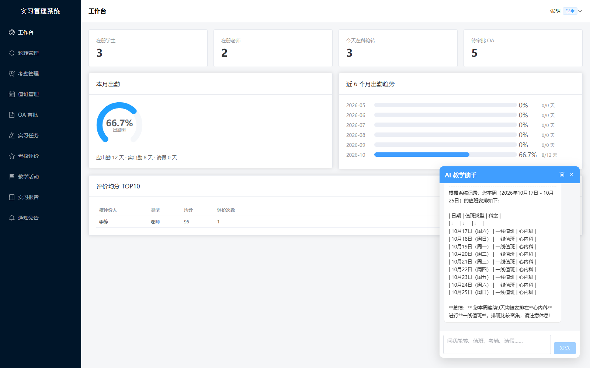
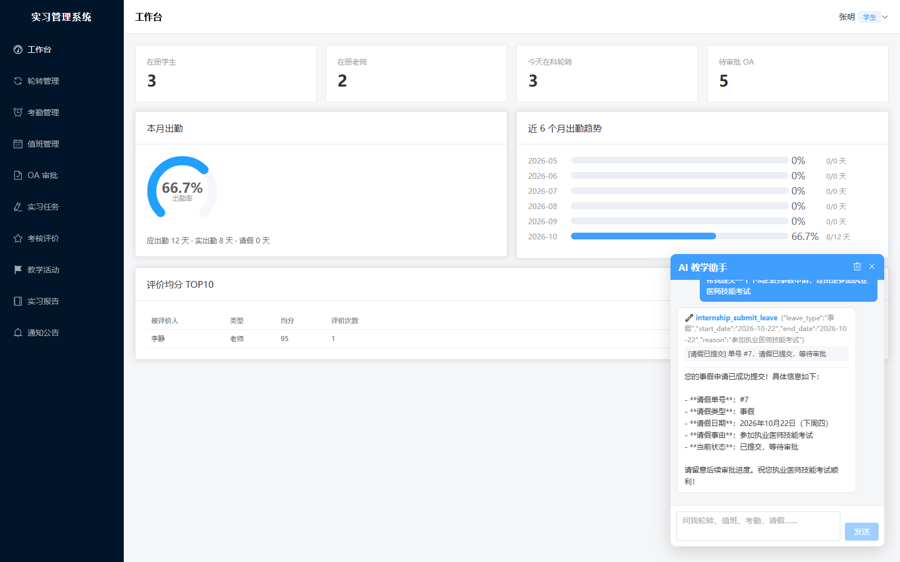
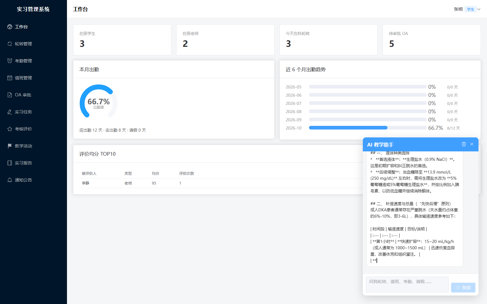
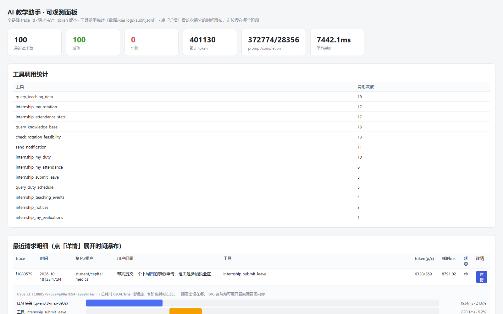
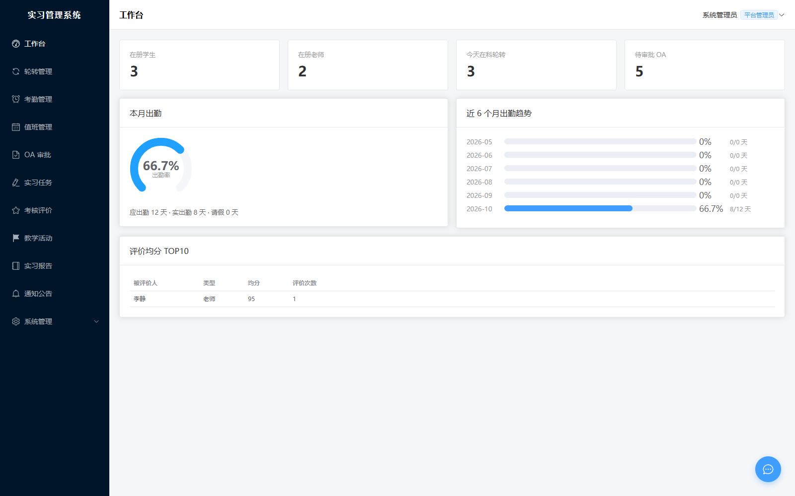
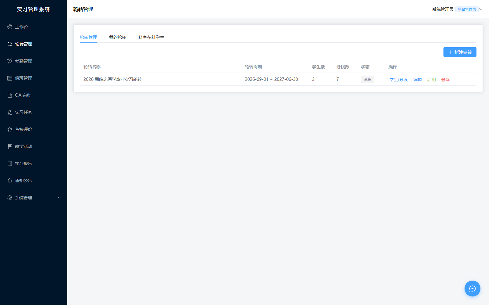
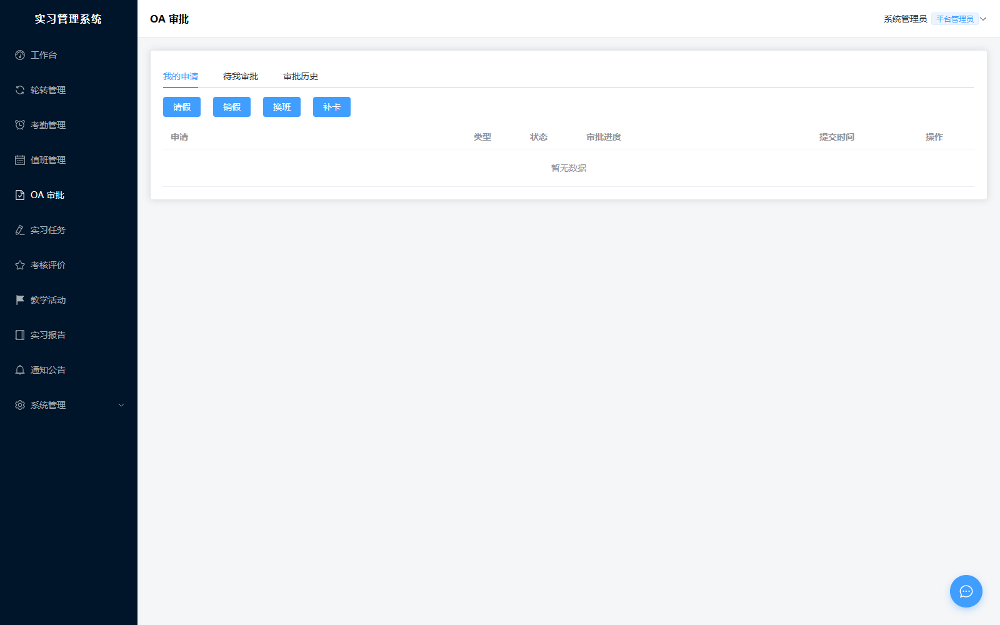
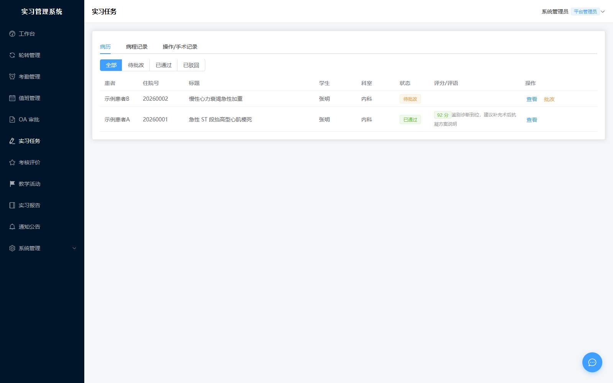
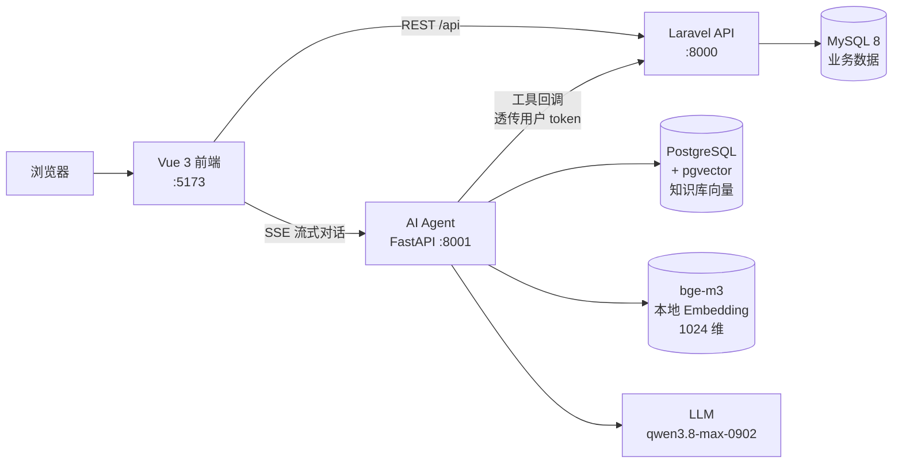

# 临床实习教学管理平台

一个面向医院教学管理的全栈系统：**轮转 · 考勤 · 值班 · 审批 · 教学任务 · 考核 · 看板** 一体化，并接入自研 **AI 教学助手**（ReAct Agent + RAG）。学生用一句自然语言就能查自己的轮转安排、出勤情况，也能直接让助手代交请假单。

> 从零重写，Laravel + Vue 全栈统一技术栈，共约 1.5 万行代码，三服务协作跑通。

---

## 一眼看懂

| | |
|---|---|
| **前端** | Vue 3.5 + TypeScript + Vite 6 + Element Plus + Pinia · 31 文件 / 4593 行 · 12 个业务模块 |
| **后端** | Laravel 12 + Sanctum + spatie/laravel-permission · 55 个类 / 3888 行 · 104 条 API · 18 张表 |
| **AI 助手** | FastAPI 自研 ReAct Agent + pgvector RAG + RBAC · 22 个模块 / 6707 行 · 13 个业务工具 |
| **回归** | API 冒烟 52/52 · 前端 UI 测试 9/9 · `vue-tsc` 类型检查全绿 |

---

## 界面预览

完整操作录屏（AI 助手：2 次工具调用 + 1 次 RAG + 观测面板反查）：[docs/demo/internship-demo.webm](docs/demo/internship-demo.webm)（浏览器可直接播放）

**AI 教学助手对话**（右下角悬浮球唤起，2 次工具调用 + 1 次 RAG 检索，真实回调业务数据）：

| 工具① 问值班安排 | 工具② 代提交请假 |
|---|---|
|  |  |
| **RAG 临床知识库问答** | **观测面板反查 trace 时间瀑布** |
|  |  |

**业务界面**：

| 工作台 | 轮转管理 |
|---|---|
|  |  |
| **OA 审批** | **实习任务（病历批改）** |
|  |  |

---

## 架构



**关键点**：AI 助手不直接碰数据库。它识别意图后回调 Laravel 的工具网关，权限完全由业务后端按调用者 token 判定——学生调老师专属工具会拿到 403。

---

## 技术栈

| 层 | 选型 | 为什么 |
|---|---|---|
| 前端 | Vue 3 `<script setup>` + TS + Element Plus | 类型安全 + 组件开箱即用，12 个模块复用同一套 CRUD 抽象 |
| 状态/路由 | Pinia + Vue Router | 菜单按角色动态渲染 |
| 后端 | Laravel 12 + Sanctum | Token 鉴权、Eloquent 关系建模、FormRequest 统一校验 |
| 权限 | spatie/laravel-permission + 自定义 role 中间件 | 四角色：admin / teaching-admin / teacher / student |
| 数据库 | MySQL（InnoDB） | 排班、考勤、审批流涉及事务与外键 |
| AI 编排 | 自研 ReAct 循环 | 规划 → 工具调用 → 观察 → 再决策 → 反思，含防死循环与 token 预算治理 |
| 检索 | pgvector（HNSW）+ BM25 → RRF 融合 | 向量召回与关键词召回互补 |
| Embedding | bge-m3 本地模型 | 医疗数据不出域，1024 维 L2 归一化 |

---

## AI 教学助手（本项目的核心）

不是调 SDK 套壳，是**手写 Agent 循环**：

- **ReAct 编排**：`Planner` 可插拔（关键词规则 / 真实 LLM `tool_calls`），支持多轮工具调用与再决策
- **13 个业务工具**：查轮转 / 值班 / 考勤 / 出勤统计 / 请假记录 / 教学活动 / 公告 / 考核 / 病历 / 待办汇总，外加教师专属的科室学生查询与待审批查询，以及**代提交请假**
- **角色白名单鉴权**：工具调用前过 RBAC 二次校验，越权直接 403
- **SSE 流式**：前端气泡能看到 `🔧 工具名 → 参数 → 返回结果` 的每一步，不是黑盒
- **可观测**：自带 `/observability` 面板，记录每次工具调用耗时与链路

真实对话示例（实测）：

```
学生：我下周的轮转安排是什么？
  🔧 internship_my_rotation  →  返回 3 条分段明细
助手：你下周（10/20-10/26）在心内科，带教老师李医生…

学生：帮我请明天一天的事假
  🔧 internship_submit_leave {date: 10-19, reason: 事假}
助手：已提交请假单 #8，当前状态：待审批
```

---

## 功能清单

| 模块 | 实现要点 |
|---|---|
| 登录认证 | 账号密码 + Sanctum Token，禁用账号拦截 |
| 组织架构 | 科室树 CRUD，祖先链搜索，删除前校验引用 |
| 用户管理 | CRUD、角色分配、禁用、类型/关键词筛选 |
| 轮转管理 | 一批学生 + 总周期，按「学生 × 科室 × 起止」分段；校验须在周期内、同学生不重叠、须为成员 |
| 考勤 | 班次、考勤组 GPS 围栏、批量排班、打卡（迟到/早退/围栏外判定）、打卡日历、月度出勤率 |
| 值班 | 师生值班表批量排班、值班日志（含可查阅人授权） |
| OA 审批 | 请假 / 销假 / 换班 / 补卡四类，自定义多级审批链；通过后自动回写考勤与值班表 |
| 实习任务 | 病历 / 病程 / 操作记录：学生书写提交，老师批改评分或驳回，权限隔离 |
| 考核评价 | 可配置评价模板（题目 + 分值），逐题评分 |
| 教学活动 | 发布、签到签退、老师查看签到并打分 |
| 实习报告 | 实习总结 / 出科报告，提交批改流程 |
| 通知公告 | 管理员发布，全员可见 |
| 统计看板 | 师生数、在科轮转数、待办、本月出勤率、6 个月趋势、评价均分 TOP10 |

---

## 快速开始

前置：PHP 8.2 + Composer、Node 18+、MySQL（也可只用 SQLite）、可选 PostgreSQL + pgvector（AI 助手 RAG 需要）。

```bash
# 1) 后端
cd internship-server
composer install
cp .env.example .env && php artisan key:generate
#   编辑 .env 填 DB_*，然后：
php artisan migrate --seed
php artisan serve                 # http://127.0.0.1:8000

# 2) 前端（另开终端）
cd internship-web
npm install
npm run dev                       # http://127.0.0.1:5173

# 3) AI 助手（可选，另开终端）
cd ../ai-service                  # 独立仓库，见文末链接
pip install -r requirements.txt && cp .env.example .env
python scripts/run_server.py      # http://127.0.0.1:8001
```

Windows 下也可以用一键脚本：`/usr/bin/bash scripts/start.sh`（起 MySQL + 后端 + 前端 + AI 服务），`scripts/stop.sh` 停止。

### 测试账号

| 账号 | 密码 | 角色 |
|---|---|---|
| `admin` | `admin123456` | 平台管理员 |
| `teacher01` | `teacher123` | 带教老师 |
| `student01` | `student123` | 学生 |

### 回归测试

```bash
/usr/bin/bash scripts/smoke-api.sh    # API 冒烟 52 项，含 AI 工具网关 10 项
node scripts/ai-ui-test.js            # AI 对话框 UI 测试 9 项，含刷新持久化
cd internship-web && npx vue-tsc -b   # 类型检查
```

---

## 目录结构

```
.
├── internship-server/     # Laravel 12 后端（104 条 API）
├── internship-web/        # Vue 3 + TS 前端
├── scripts/               # 启停脚本 + 冒烟/UI 回归
├── 医院项目重写规划.md      # 分期规划（P0~P4）
├── AI助手对接设计.md        # AI 助手对接协议与工具契约
└── 新系统运行说明.md        # 本地运行细节与踩坑记录
```

---

## 已知限制

诚实列出，不藏：

- **AI 助手记忆是进程内的**：服务重启后上下文会丢，前端用 localStorage 兜住对话显示的连续性。切 Redis 只需改 `MEMORY_BACKEND=redis`，不用改代码。
- **没有做过并发压测**：本项目是教学管理场景，用户量在百级，追求的是业务完整性与 AI 工程能力，不是高并发。压测数据暂缺。
- **RAG 召回有正式评测但样本不大**：内置评测集 RAG 4/4、Text2SQL 5/5（每条都真执行验证），属于小样本自评，未做大规模召回率统计。
- **Embedding 可切 mock**：默认 bge-m3 真模型（首次自动下载约 2GB），开发调试可设 `EMBEDDING_MODE=mock` 用本地哈希兜底，此时检索质量弱。

---

## 相关仓库

- **AI 教学助手服务**（ReAct Agent + RAG + RBAC，独立微服务）：见同一作者的 `ai-service` 仓库

---

## License

MIT
